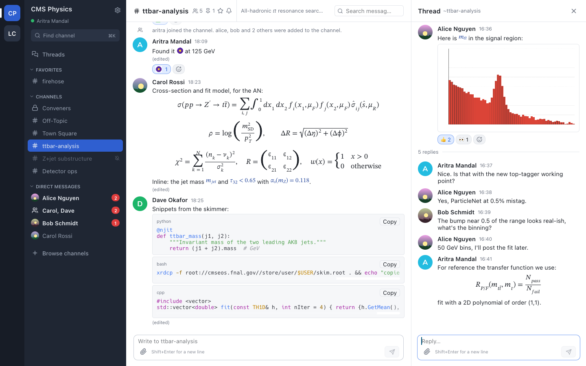
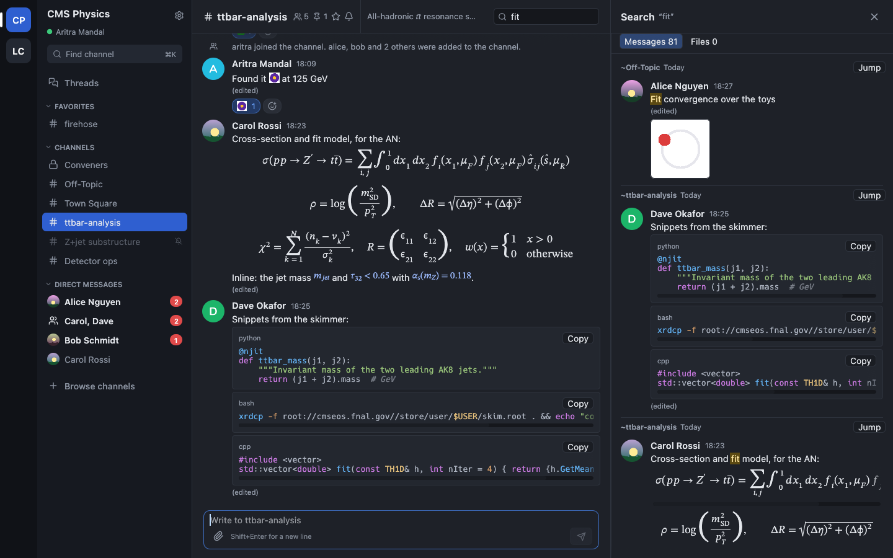
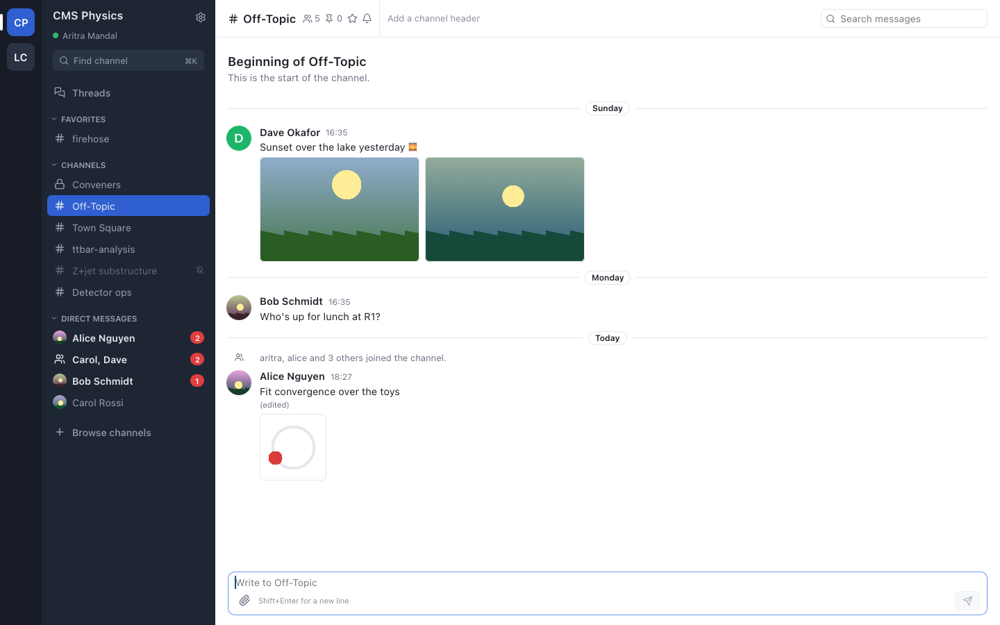

<h1 align="center">mmfast</h1>

<p align="center"><strong>Mattermost, native and fast.</strong><br>
A small desktop client for Mattermost, written in Rust, with no browser engine.</p>

<p align="center">
  
  
  
</p>



mmfast covers the parts of Mattermost you use all day: channels, threads,
images, attachments, the channel header and search. It leaves out calls,
boards, playbooks and plugins. It is built the way
[Spotifast](https://github.com/crmne/spotifast) and
[ZapFast](https://github.com/crmne/zapfast) are, on their shared
[fastframe](https://github.com/crmne/fastframe) crates.

Not affiliated with Mattermost, Inc.

## Why

Mattermost Desktop is an Electron app: a bundled Chromium running the
Mattermost web app. mmfast draws its interface directly with
[egui](https://github.com/emilk/egui).

Measured on one Mac, both apps on the same CERN Mattermost account with warm
caches, three fresh launches each (medians; script and raw numbers in
[`bench/`](bench)):

| | Mattermost Desktop 6.3 | mmfast |
|---|---:|---:|
| Main window created | 517 ms | 533 ms |
| Startup finished (CPU settles) | 4.64 s | **0.82 s** |
| CPU spent starting | 4.38 s | **0.59 s** |
| Memory footprint | 669 MB | **212 MB** |
| Processes / threads | 10 / 191 | **1 / 9** |
| CPU while idle, per 30 s | 1.25 s | **0.08 s** |
| App size | 241 MB | **16 MB** |

"Window created" is the window server's first record of the window, not its
first paint. Mattermost Desktop does much more (plugins, calls, boards), so
part of its cost pays for features mmfast leaves out.

## What it does

**Chat.** Channels, private channels, DMs and group messages across teams,
in your own sidebar categories with favorites. Muted channels stay quiet.
Unread and mention badges, also on the Dock. Markdown with tables, quotes
and lists, @mentions, ~channel links, emoji and the server's custom emoji.
Edit, delete, pin, react. Typing indicators. Desktop notifications that
follow your Mattermost notification settings. Profile cards, browse and join
channels, start a DM with anyone. Join and leave messages fold into one line.

**Threads.** Reply counts on messages, a thread panel with its own composer,
and a Followed threads view.

**Math and code.** Display math (`$$…$$` and ```` ```latex ```` blocks) is laid
out like TeX in STIX Two Math: fractions, roots, sums and integrals with
limits, matrices and cases. Inline `$…$` uses math italics. Code blocks are
highlighted for Python, C/C++, shell, Rust, Go, JS/TS, JSON/YAML/TOML, SQL and
diffs, with a Copy button.

**Images and files.** Thumbnails sized before they load, animated GIFs (only
while on screen), a lightbox with zoom and pan, file cards with open and
download. Upload with the paperclip, by drag and drop, or by pasting an image.

**Channel header and search.** Name, members, pinned messages, the header
text (click to read it all, or edit it). Search shows matches from the local
cache as you type; Enter searches the server, messages and files, with
Mattermost's syntax (`from:`, `in:`, `before:`, `after:`, `"phrases"`,
`-exclude`). Jump to any result, even far back in history.

**Stays out of the way.** Closing the window keeps mmfast in the menu bar,
still receiving and notifying. Links to your server open inside the app.
Cmd/Ctrl+K switches channel, Cmd/Ctrl+F searches, Alt+↑/↓ moves between
channels, ↑ in an empty box edits your last message.

<table>
  <tr>
    <td></td>
    <td></td>
  </tr>
  <tr>
    <td align="center">Search, dark theme</td>
    <td align="center">Images and GIFs</td>
  </tr>
</table>

## Install

Build it from source. You need Rust (via [rustup](https://rustup.rs); the
repository pins the version) and, on Linux, the D-Bus development files
(`libdbus-1-dev` on Debian and Ubuntu).

```sh
git clone https://github.com/mandalaritra1/mmfast
cd mmfast
cargo run --release
```

On macOS, `./dev/bundle-macos.sh` builds `dist/mmfast.app`; drag it to
Applications. Run `./dev/make-signing-identity.sh` once first, so macOS
stops asking to approve keychain access after every rebuild.

## Sign in

Choose **Sign in with browser (SSO)**. mmfast asks the server which single
sign-on it uses (GitLab, as at CERN, or OpenID, Office 365, Google, SAML) and
opens it in your browser; the session comes back to the app through an
`mmauth://` link. Password (with MFA) and access tokens work too. The
session is kept in the macOS Keychain or GNOME Keyring.

## How it stays fast

- **No browser engine.** egui draws the interface with OpenGL.
- **The window never waits.** Networking, disk and image decoding run on a
  separate thread, which talks to the interface through messages and
  repaints only when something changed. An idle window costs no CPU.
- **Your channels appear before the server answers.** A local SQLite cache
  (with full-text search) shows what you last saw, then the server catches up.
- **What you do shows at once.** Sent messages, edits and reactions appear
  immediately; the server's answer replaces them in place.
- **Only what is on screen is laid out**, and images that scroll far away
  leave GPU memory.

[AGENTS.md](AGENTS.md) describes the architecture in detail.

## Linux

Checked on Ubuntu 26.04 with GNOME, on Wayland and X11: the same features,
sessions in GNOME Keyring, notifications over D-Bus. GNOME has no tray, so
closing the window quits there. Install `fonts-stix` for the math font;
without it, math uses fallback fonts. Windows should build but is untested.

## Development

A local Mattermost server with seeded test data:

```sh
docker run --platform linux/amd64 --name mattermost-preview -d -p 8065:8065 \
  -e MM_SERVICESETTINGS_ENABLELOCALMODE=true mattermost/mattermost-preview
python3 dev/seed.py      # users, teams, channels, threads, images, files
cargo run -- --dev       # signs in as the seeded user
```

`--script` drives the app and saves screenshots
(`--script "channel:ttbar-analysis;wait:1500;shot:out.png;quit"`; the steps
are listed in [src/script.rs](src/script.rs)). `dev/post_as.py` posts as
another user to check live delivery. `cargo test` runs the unit tests.

## Thanks

mmfast stands on [egui](https://github.com/emilk/egui) and Carmine Paolino's
[fastframe](https://github.com/crmne/fastframe) (fonts, colour emoji, icons,
scrolling, the menu-bar shell). Its design follows
[Spotifast](https://github.com/crmne/spotifast) and
[ZapFast](https://github.com/crmne/zapfast); the macOS link handler is adapted
from Spotifast. Icons are [Lucide](https://lucide.dev) (ISC).

## License

MIT. See [LICENSE](LICENSE). Mattermost is a trademark of Mattermost, Inc.
